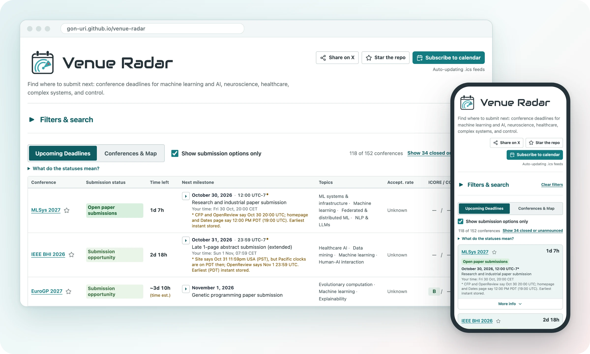
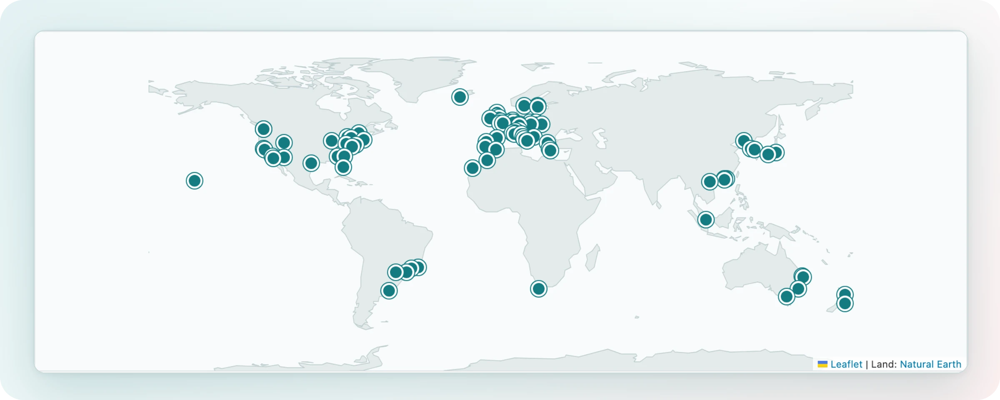

<picture>
  <source media="(prefers-color-scheme: dark)" srcset="assets/branding/venue-radar-banner-dark.png">
  
</picture>

# [Open Venue Radar](https://gon-uri.github.io/venue-radar/)

Find where to submit next: conference deadlines for machine learning and AI,
neuroscience, healthcare, complex systems, and control.

 
130+&nbsp;conference&nbsp;series&nbsp;· Free&nbsp;· No&nbsp;account&nbsp;· Works&nbsp;on&nbsp;your&nbsp;phone

 

## Deadlines at a glance

- **In your time zone.** A countdown to each conference's next submission
  deadline and, once the cutoff hour is confirmed, the exact time with its zone
  (such as 23:59 AoE) and the same moment in your own time.
- **Honest about uncertainty.** Estimated dates are marked "~" and "(est.)". When
  official sources disagree, the earliest cutoff is shown with a note.
- **Filtered to your field.** Topics and subtopics, conference size, ICORE and CCF
  rank, and historical acceptance rate. Any filtered view can be shared as a link.
- **Your shortlist.** Star the series you follow and show only those. Stars stay
  in your browser.
- **Sourced.** Each conference links its official sources and shows when it was
  last checked.

## Coverage

Conferences in eight topic families, each with its own subtopics:
ML&nbsp;&amp;&nbsp;Data&nbsp;Science&nbsp;·
NLP,&nbsp;Agents&nbsp;&amp;&nbsp;Retrieval&nbsp;·
Vision&nbsp;&amp;&nbsp;Multimedia&nbsp;·
RL,&nbsp;Robotics&nbsp;&amp;&nbsp;Control&nbsp;·
Complex&nbsp;Systems, Time&nbsp;Series&nbsp;&amp;&nbsp;Signals&nbsp;·
Healthcare&nbsp;&amp;&nbsp;Biometrics&nbsp;·
Neuroscience&nbsp;&amp; Neurotechnology&nbsp;·
Responsible&nbsp;&amp;&nbsp;Trustworthy&nbsp;AI.

Confirmed host cities of upcoming conferences, from the Conferences &amp; Map tab.

Missing a conference? [Send a request](https://github.com/gon-uri/venue-radar/issues/new?template=conference-request.yml).

## Subscribe once

Open **Subscribe to calendar** on the site and choose Google or Apple. In Outlook,
use *Add calendar › Subscribe from web* and paste a copied link. Subscribed feeds
update when Venue Radar changes (Google can take up to a day to refresh); a
downloaded file does not. To subscribe in another calendar app, copy one of
these links (opening one downloads a one-time file):

- [Submission deadlines](https://gon-uri.github.io/venue-radar/submissions.ics):
  new-paper and abstract deadlines, including required registration steps
- [All events](https://gon-uri.github.io/venue-radar/calendar-all.ics): meeting
  dates plus every recorded deadline
- [Conference dates](https://gon-uri.github.io/venue-radar/conferences.ics):
  meeting dates only
- **One topic**, or **one conference series** including future editions: pick
  it on the site

## Checked by hand

Dates come from official conference pages and are checked by hand. Dates that
are not announced yet are estimated, usually from the previous edition, and
labelled as estimates, never shown as confirmed. Venue Radar helps you plan, but the official
call for papers has the final word: please double-check it before you submit.

<b>What do "~", "(est.)" and "(time est.)" mean?</b>

"~" and "(est.)" mark an estimated countdown or date: projected from the previous
edition or not yet confirmed by the organizers. "(time est.)" means the day is
official but the cutoff hour has not been announced.

<b>Do acceptance rates tell me my chances?</b>

No. They are historical figures shown with their year, such as "27% (2025)",
or a band marked "(estimated)" where only approximate evidence exists: context
about how selective a venue has been, not a prediction for your paper.

<b>How does a conference get added?</b>

Use the request form linked under Coverage and include the official website.
Requests are reviewed by hand, and a conference is listed once its dates have
been checked against its official pages.

## Help keep it accurate

Spotted an error or have an idea for a new feature? [Open an issue](https://github.com/gon-uri/venue-radar/issues/new).
For a wrong or outdated date, use **Report outdated info** on that conference: it
opens a prefilled [correction form](https://github.com/gon-uri/venue-radar/issues/new?template=correction.yml).
Questions are welcome in the comments on the website or in
[Discussions](https://github.com/gon-uri/venue-radar/discussions).
Maintaining the data or the site? Start with the [project documentation](project_docs/README.md).

If Venue Radar saves you time, please **star this repository** and
[follow @gonzauri on X](https://x.com/gonzauri).

---

Created and maintained by **Gonzalo Uribarri**, Assistant Professor at the
Department of Computer and Systems Sciences,
Stockholm University. 
[University profile](https://www.su.se/profiles/g/gour8957) ·
[Google Scholar](https://scholar.google.com/citations?user=q5sweuIAAAAJ&hl=en) ·
[GitHub](https://github.com/gon-uri)

Code is available under the [MIT license](LICENSE). Original written content
and original project artwork are available under [CC BY 4.0](CONTENT-LICENSE.md).
Both allow commercial reuse with the required attribution/notices. Third-party
material retains its own terms ([notices](THIRD_PARTY_NOTICES.md)). Venue Radar
is a personal project by Gonzalo Uribarri, not an official Stockholm University
service.
